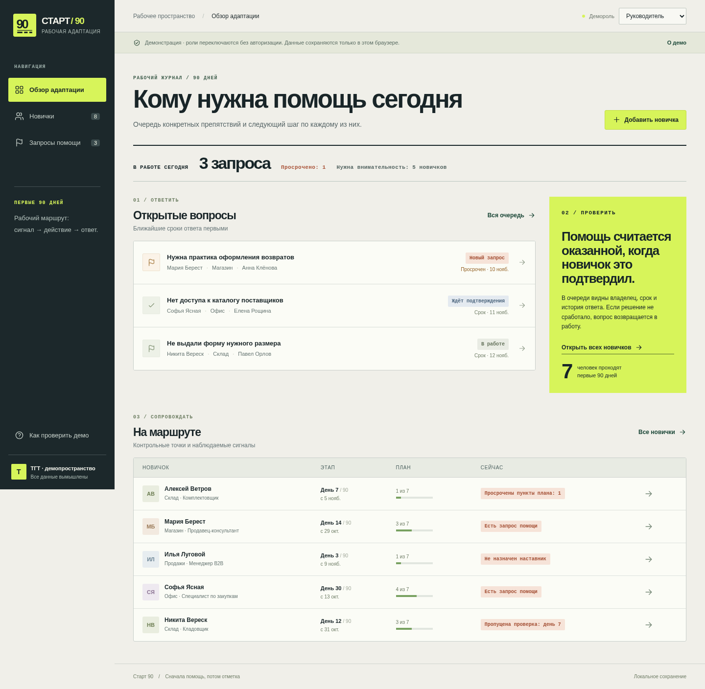

# Старт 90

Рабочая браузерная демонстрация сопровождения новичка: **сообщить о препятствии → назначить действие → передать решение → получить подтверждение новичка**.

**Демо:** https://tgt.myvelum.com/ · **Код:** https://github.com/zatercivil-stack/start90

Создано по тестовому заданию ТГТ. Все имена, роли, запросы и шаблоны вымышлены. Продуктовая гипотеза не проверена на данных компании. Реальной интеграции с Битрикс24 нет.



[Смотреть демонстрацию, 41 секунда](https://tgt.myvelum.com/video.html) · [Отчёт для HR](HR_REPORT.md) · [Проверки](docs/TESTING.md)

## Запуск

Требуется Node.js 22+. Приложение не требует установки пакетов или API-ключей:

```sh
npm start
```

Открыть http://127.0.0.1:4173. Другой локальный порт: `PORT=4174 npm start` (Linux/macOS). Сервер слушает только loopback. Не открывать index.html через file://: используются ES-модули.

Весь deployable интерфейс находится в `dist/`. Его можно разместить на обычном статическом HTTPS-хостинге. Runtime не зависит от CDN, шрифтов, LLM или внешних API.

## Проверить за три минуты

1. В «Новичках» найдите **Алексея Ветрова** и откройте карточку.
2. Нажмите «Посмотреть глазами новичка». В «Проверках» пройдите день 7: «Да / Нет / Да», комментарий «Нет доступа к ТСД, не могу собирать заказы».
3. Переключите демороль на «Руководитель», откройте «Запросы помощи» и новый запрос «Нужна помощь · проверка дня 7».
4. Укажите первое действие и нажмите «Взять в работу». Откройте запрос снова, укажите решение и нажмите «Передать на подтверждение».
5. Переключитесь на «Новичок», вкладка «Запросы». Подтвердите результат с комментарием либо нажмите «Проблема осталась».
6. Перезагрузите страницу. В «Запросах помощи» → «Решённые» сохранится подтверждение и история.

Для нового прогона: «Как проверить демо» → «Сбросить демо» → явное подтверждение. Можно экспортировать JSON перед сбросом. Если демо открыто давно, контрольные даты сдвигаются естественным образом; сброс создаёт свежий сценарий относительно текущего дня.

## Что работает

- 8 вымышленных новичков, четыре подразделения, семь пунктов плана на шаблон.
- Добавление новичка, поиск и фильтр подразделений, назначение наставника, выполнение плана.
- Проверки дней 3/7/14/30/60/90, прямой запрос помощи, маршрутизация руководителю или HR.
- Ответственный, срок, комментарии действий, подтверждение и возврат запроса новичком.
- Объяснимые сигналы без оценки «риска увольнения», очередь запросов и фильтры статуса.
- Версионированное локальное сохранение, защита от повторной проверки, сообщения при ошибке записи, экспорт и сброс.
- Русский интерфейс, мобильный layout, работа форм с клавиатуры, системные шрифты и собственные SVG-иконки.

## Архитектура

- `dist/domain.js`: чистые функции дат, шаблонов, сигналов, валидации и переходов состояния. Команда возвращает копию; ошибка не изменяет исходное состояние.
- `dist/app.js`: отрисовка, события, формы и адаптер browser-local хранилища. Запись происходит до обновления UI; при неудаче нет ложного подтверждения сохранения. Пользовательские строки экранируются.
- `dist/styles.css`: адаптивная система компонентов.
- `server.mjs`: минимальный локальный сервер статических файлов.
- `tests/domain.test.mjs`: бизнес-правила и ошибочные переходы.
- `tests/app.spec.js`: сквозные браузерные сценарии.

Сущности: Employee с PlanTask, CheckIn, Issue с IssueEvent. localStorage key: `start90.demo.v1`; версия схемы 1. Даты бизнеса — Europe/Minsk; история событий хранится ISO UTC и показывается по Минску. Ревизия помогает обнаружить изменение в другой вкладке, но localStorage не предоставляет транзакционную многопользовательскую блокировку.

## Проверки разработчика

```sh
npm ci
npm run check
npm test
npx playwright install chromium
# В отдельном терминале: npm start
npm run test:e2e
```

Chromium нужен только для тестов, не для запуска приложения. Результаты E2E записываются в `artifacts/e2e-results.json`; скриншоты в `artifacts/`. См. `docs/TESTING.md` для фактического прогона.

## Ограничения

Это **однопользовательская демонстрация с переключением ролей**, не многопользовательская HR-система. Состояние принадлежит одному браузеру и origin; другой браузер или адрес создаёт отдельную копию. Очистка browser storage удалит изменения. Экспорт — JSON без импорта. Нет серверной БД, входа по учётным записям, контроля доступа, фоновых уведомлений, согласованного SLA, резервных копий на сервере или реальных регламентов.

Все демороли могут просматривать обращения, включая направленные HR: **это не конфиденциальный канал**. В настоящем пилоте нужны серверное хранилище, аутентификация, разграничение доступа и правила обработки персональных данных. Не вводите реальные сведения.

Ничего не известно о причинах увольнений в ТГТ; влияние решения на удержание не доказано. Не приписывайте разработчику интеграцию с порталом компании.

## Материалы

- `docs/DECISIONS.md` — выбор задачи, бизнес-правила и план пилота.
- `docs/BITRIX24.md` — проверенные API-возможности и граница будущего адаптера.
- `docs/TESTING.md` — результаты и пределы проверки.
- `HR_REPORT.md` — отчёт до 15 строк.
- `docs/DEMO.md` — сценарий демонстрации.

Код проекта не использует и не изменяет StreamScope. Вся реализация выполнена в отдельной директории.

## Развёртывание

Публичная демонстрация обслуживается Caddy на tgt.myvelum.com с HTTPS. Отдельный каталог `/var/www/start90`, конфигурация нового домена в `/etc/caddy/start90.caddy`. Node-сервер для production не нужен. См. `docs/DEPLOYMENT.md`.

## Визуальная система

Обзор построен как рабочий журнал: открытые вопросы и конкретные действия стоят выше сводных чисел. Знак «90» обозначает длительность маршрута; три штриха под числом напоминают отметки контрольных точек. Для оформления использованы принципы [taste-skill](https://github.com/leonxlnx/taste-skill), без его runtime-кода и внешних ресурсов.

## CI и публикация

Вкладка [Actions](https://github.com/zatercivil-stack/start90/actions) запускает проверку синтаксиса, 17 тестов правил и 8 браузерных сценариев на push в `main`, в pull request и вручную. При сбое сохраняются диагностика Playwright и трассы. Публикация на VPS выполняется отдельно по инструкции `docs/DEPLOYMENT.md`: для GitHub нет ключей доступа к серверу, поэтому workflow не выполняет автоматический деплой.
